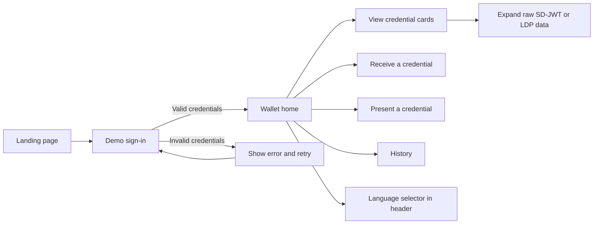
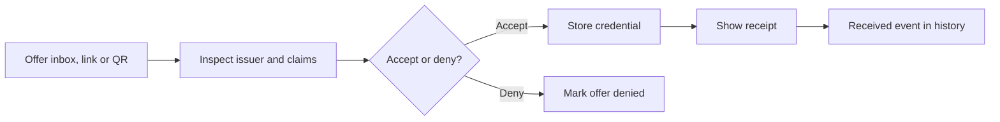
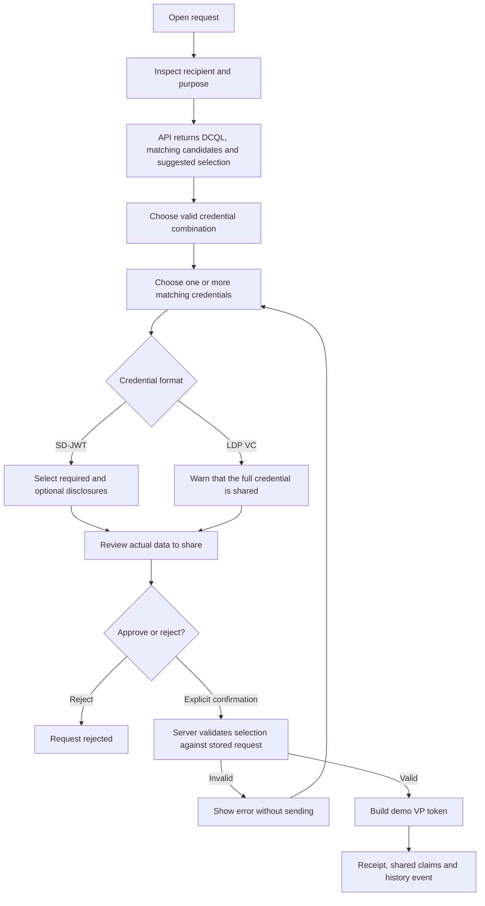
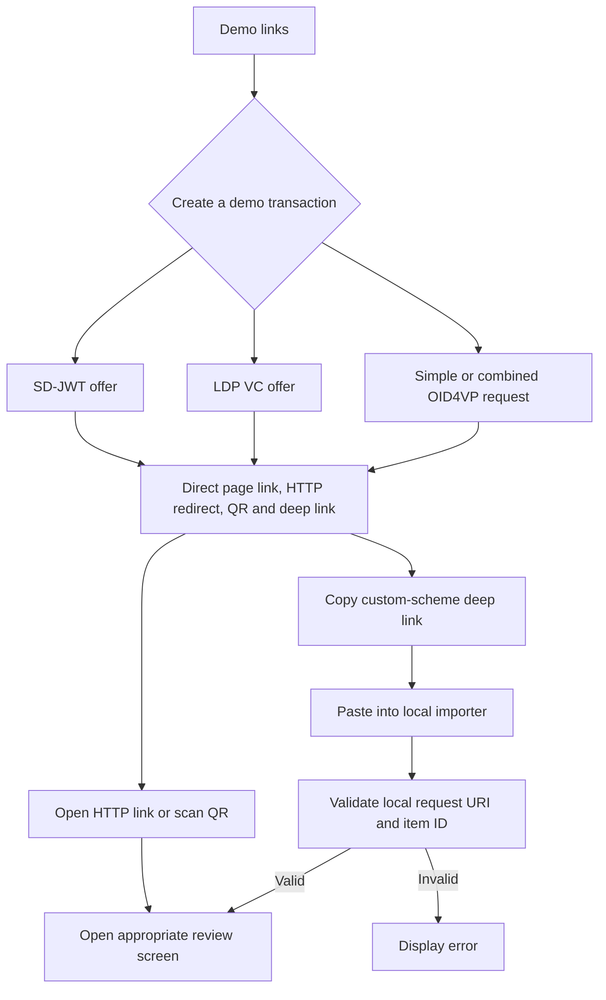
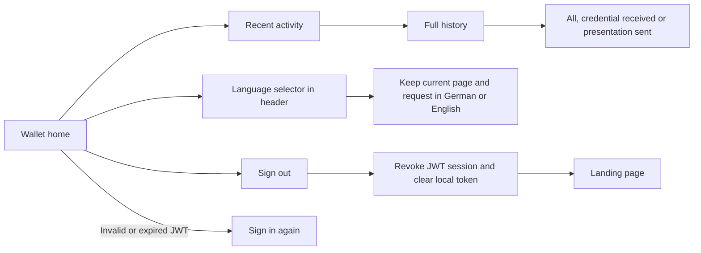
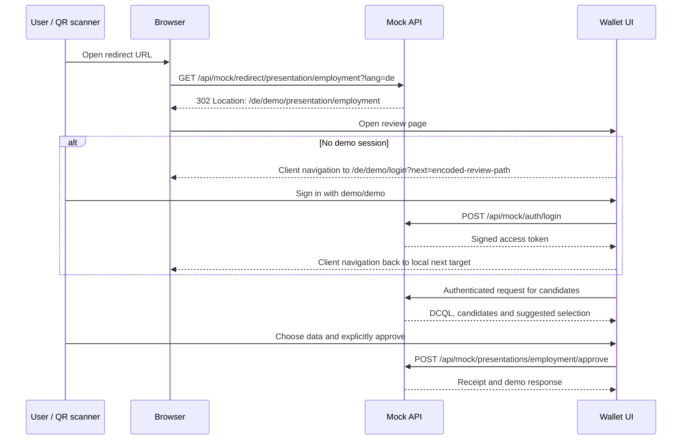
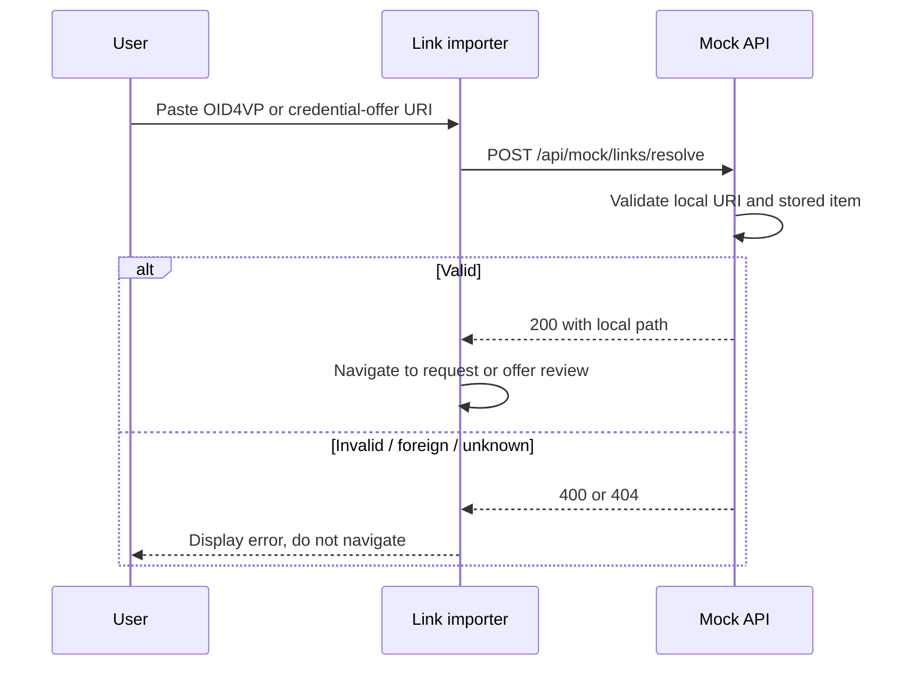
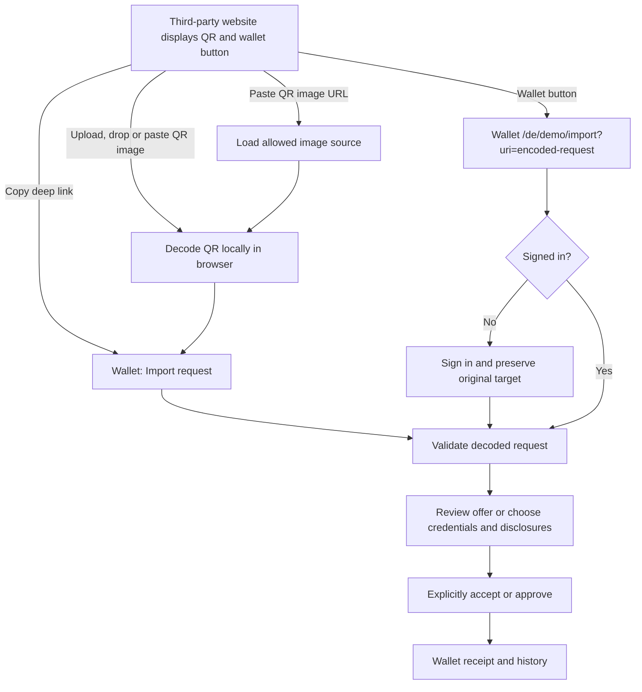

# XFSC Cloud Wallet

A simplified wallet UI with two separate operating modes: a configurable Keycloak-backed wallet and a local JWT-backed mock demonstrating credential receipt and manual OID4VP presentation consent.

## Quick start: local mock

```sh
npm ci
npm run demo
```

Open the simulated third-party website at http://localhost:4101, or the wallet at http://localhost:3000/de/demo. Username **demo**, password **demo**. No separate Keycloak server, database or backend process is required. `npm run demo` sets `MOCK_MODE=true` and starts both Next.js and a separate partner website on port 4101. Ctrl+C stops both processes.

An optional standalone API is available through `npm run mock:backend` at http://127.0.0.1:4100. It has its own in-memory state; the integrated UI uses its embedded backend, not that separate process.

The two landing-page Sign in actions are native demo-login links in mock mode and do not depend on client-side click interception. If Keycloak mode has no configuration, the landing page displays a configuration message; local development points to `npm run demo`.

## Keycloak mode

Copy `.env.local.example` to `.env.local` and set:

```dotenv
KEYCLOAK_AUTH_URL=https://auth.example.org
KEYCLOAK_REALM=your-tenant
KEYCLOAK_CLIENT_ID=wallet-web
WALLET_API_URL=https://your-tenant.example.org/api
WALLET_ACCOUNT_SERVICE_URL=https://your-tenant.example.org/api/accounts
```

Run `npm run dev` and open http://localhost:3000/de. Leave `MOCK_MODE` unset or false. The server embeds the public runtime auth/API configuration in the initial page; clicking Sign in does not first fetch `/api/keycloak-config` or OIDC discovery. The Keycloak adapter uses Authorization Code Flow with PKCE S256. Configure the public client, allowed redirect URIs and Web Origins for the application address. Never put a client secret in the browser configuration. Restart the app after changing environment values.

For a production build: `npm run build`, then `npm start`. For a local production-mode mock, set `MOCK_MODE=true` for **both** commands. A build is required before `npm start`.

## Visual previews

These are the concept images discussed during design, with German labels. They are **not screenshots of the running application**, nor pixel-exact representations of every implemented page. The screen inventory and flow diagrams below describe the implementation. No live browser walkthrough has been verified. The QR decoder and partner/backend flow have automated tests.

### Public landing page


### Wallet home


### Presentation consent


## Implemented mock screen inventory

| Screen | Route | Main actions |
| --- | --- | --- |
| Public landing | `/de` | Sign in, language switch, FAQ |
| Demo sign-in | `/de/demo/login` | Sign in using demo/demo; resume a pending local target |
| Wallet home | `/de/demo` | Receive/present entry points, credential cards, raw data, recent activity |
| Offer inbox | `/de/demo/offer` | Open an offer |
| Offer review and receipt | `/de/demo/offer/welcome` or `/de/demo/offer/:id` | Inspect issuer/claims, accept or deny, show receipt |
| Presentation inbox | `/de/demo/presentation` | Open a presentation request |
| Presentation selection and receipt | `/de/demo/presentation/employment` or `/de/demo/presentation/:id` | API preselection, credential/disclosure choices, review, approve or reject, inspect response |
| History | `/de/demo/history` | Filter received credentials and sent presentations |
| Language selector | Header on landing, login and wallet | Switch Deutsch / English while keeping the current flow; old settings URLs redirect home |
| Link generator and importer | `/de/demo/links` | Create SD-JWT/LDP offers or simple/combined OID4VP requests; show QR, copy/import deep links |
| Third-party request import | `/de/demo/import` | Partner redirect, deep link, QR image URL, file upload, drop or clipboard image |

`/en/demo/...` provides English navigation. Demo interface labels, consent/import text and known fixture display labels switch language. Raw protocol payloads and stored data are not modified. New generated item IDs are displayed in the link generator. Demo screens and endpoints return 404 when mock mode is disabled.

## UX flows

### Sign-in, credentials and navigation



### Receive an offer



Previously processed offers cannot be accepted again. An accepted credential appears on the home screen.

### Presentation request and selective disclosure



Every credential, combination or disclosure change clears the confirmation. Missing required claims prevent submission. Server-side checks reject unknown candidates, extra disclosures, duplicate selections and invalid combinations. SD-JWT output contains only selected disclosures; LDP VC output contains the complete credential with a visible warning. Terminal requests cannot be approved again. API recommendations are not user consent.

The `candidates`, `approve`, `reject` routes and `selections/queryId/credentialId/disclosures` structure follow the locally supplied OID4VP Holder code. `suggestedSelection` and explicit combinations are mock extensions. The remote GitHub branch was not retrievable during implementation; equivalence to its latest revision has not been verified. See the [detailed mock notes](mock/README.md#oid4vp-auswahl-und-selektive-offenlegung).

### Generate and import links



### History, direct language switch and session end



## Redirects: exact behavior

### Browser links and QR codes

The internal link-generator QR still contains a normal HTTP redirect URL. The third-party demo QR contains the OID4VP/offer deep link directly:

```text
http://localhost:3000/api/mock/redirect/offer/welcome?lang=de
http://localhost:3000/api/mock/redirect/presentation/employment?lang=de
```

The backend returns **HTTP 302** with a relative `Location` pointing to `/de/demo/offer/welcome` or `/de/demo/presentation/employment`. `lang=en` selects `/en`; other values fall back to `/de`. The redirect itself does not accept an offer, disclose data, verify a token or perform fulfillment. Missing item IDs are reported by the subsequent review page.



A fresh unauthenticated entry preserves the requested local path and query in `next`. The sign-in form only resumes a target beginning with the current locale's `/demo/` prefix; other targets fall back to the demo home. On token expiry, the current pathname and query string are retained for sign-in. Tokens are not added to redirect URLs.

### Custom-scheme OID4VP and credential-offer links

```text
openid4vp://authorize?request_uri=<encoded local /api/mock/requests/presentation/:id URL>
openid-credential-offer://?credential_offer_uri=<encoded local /api/mock/requests/offer/:id URL>
```

These links can be handed to the wallet by the partner redirect, pasted into the import field, or decoded from a QR image. There is no native operating-system scheme registration or automatic browser handoff. The importer calls `POST /api/mock/links/resolve` with `{uri: ...}`. The API checks the scheme, same origin, expected request path, transaction type and stored item ID, and returns `{path: "/de/demo/..."}`. The UI adapts that path to the current locale and navigates there; **this is JSON plus client navigation, not HTTP 302**. It does not fetch arbitrary remote request URIs.



The `/api/mock/requests/...` endpoints return illustrative request/offer **JSON**. They are neither redirect endpoints nor proof that the request has been cryptographically verified.

### Real Keycloak redirects

Outside mock mode, Sign in uses the public config embedded by the server to construct the Keycloak login request with a fixed auth URL, realm and client ID. Keycloak returns to the wallet callback; the adapter handles the authorization response and PKCE exchange. Incoming `presentation` and `params` query values are carried into that callback. The local mock's JWT sign-in is a separate flow and does not contact Keycloak.

## API, tests and limitations

- [Required backend endpoints and mock/production responsibilities](docs/backend-endpoints.md)
- [Redirect routes and Bearer-token boundaries](docs/redirect-routes.md)
- [Mock API reference and protocol limitations](mock/README.md)
- [Helm chart, derived domain/tenant hostnames, Envoy HTTPRoutes and TLS](deployment/helm/README.md)
- [German implementation notes](UX-UMBAU.md)

```sh
npm run mock:test
npm run lint
npx tsc --noEmit
```

Backend tests cover JWT verification/revocation, receipt and presentation history, candidate suggestions, disclosure filtering, invalid selections, terminal request replay and local deep-link resolution. They do not constitute a browser end-to-end test or OID4VP conformance test.

State is in memory and resets on restart; demo/demo users share one demo account. SD-JWT signatures and key binding are local HMAC examples, not a production trust chain. LDP proofs are deliberately invalid test fixtures. No actual external verifier is contacted. Do not enable mock mode in a real deployment.


## Third-party website entry flow

The user starts on a third-party website, **not** in the wallet link generator. The included partner site runs at `http://localhost:4101` on a separate origin. It offers a presentation request and a credential offer, each with a QR image, image URL, deep link and a **Continue with my wallet** button.



### Ways to open the request

1. **Partner integration:** the button links to `http://localhost:3000/de/demo/import?uri=<URL-encoded OID4VP or offer URI>`. No token is included. If sign-in is required, the entire import target and query survive the login. The request then opens directly on its review page.
2. **Deep link:** paste into the wallet's **Anfrage importieren** screen, read it, and open the request.
3. **QR image URL:** paste the image's direct PNG/JPEG/WebP/GIF URL. The mock downloads it without forwarding wallet credentials, then the browser decodes the QR. Sources are restricted to the wallet origin and `MOCK_IMAGE_ORIGINS` (default `http://localhost:4101`). Unsupported sources display an error with the upload alternative. Add other demo source origins explicitly if needed; redirects to other image hosts are not followed.
4. **QR image:** upload a file, drag it onto the import area, or focus that area/input and paste an image from the clipboard with Ctrl/Cmd+V. Images are decoded locally, limited to 5 MB. A visible decoded request is shown before opening its review page.

The partner page has **QR image download**, **image URL** and **deep link** fields to exercise each entry. A QR may contain a local OID4VP/offer URI, a wallet import URL or a local HTTP redirect URL. The importer resolves these to the same review flow. Image reading alone never accepts an offer or shares credentials.

This is a partner-origin demo with locally generated request objects. Arbitrary external OID4VP request validation/fetching, native protocol registration and a result callback/automatic return to the partner are not implemented. No token, credential or VP is automatically sent back to the third-party page. After confirmation, the demo stays on the wallet receipt screen.


## Direct language switching

Use the language selector in the header on the landing page, login and wallet. It immediately switches the current route, preserves the query/hash and local login return target, and stores NEXT_LOCALE. In the authenticated mock it also saves the language preference with a non-blocking keepalive request. API recommendations and raw credential data keep their original identifiers. No settings screen is required; `/de/demo/settings` and `/de/wallet/settings` redirect to their respective home pages.


### Authentication guard before opening redirected requests

Protected demo pages verify the stored token with authenticated `GET /api/mock/auth/verify` before loading wallet data or mounting the import/consent UI. A missing token skips the verification call and opens sign-in directly. A 401/403, expired token or revoked session clears the local token and navigates to `/{locale}/demo/login?next=<encoded original path, query and fragment>`. Successful sign-in resumes that internal destination; external targets and login loops are refused. Valid sessions proceed without another sign-in. Token expiry schedules a fresh check even while the page is idle.

Temporary backend/network failures show a retry action without destroying the session or opening request data. Later protected API calls still enforce authorization and can trigger the same reauthentication flow. The real Keycloak wallet retains its SDK-based login interceptor; the explicit JWT verification guard described here is part of the local mock UI.

## Local Docker Keycloak test

See [LOCAL-LOGIN-TEST.md](LOCAL-LOGIN-TEST.md) for the isolated real-Keycloak login environment.
