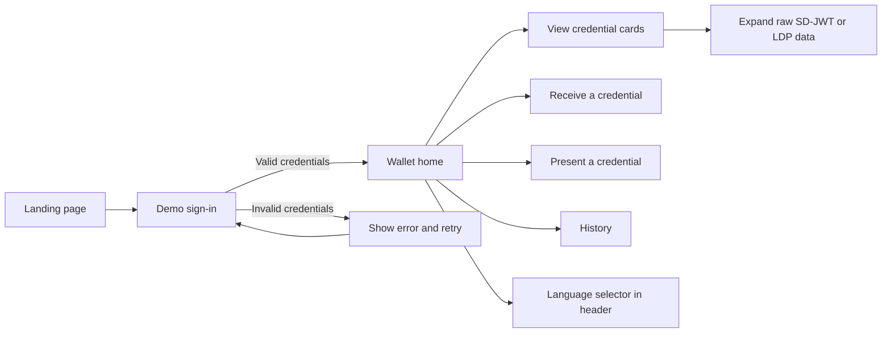
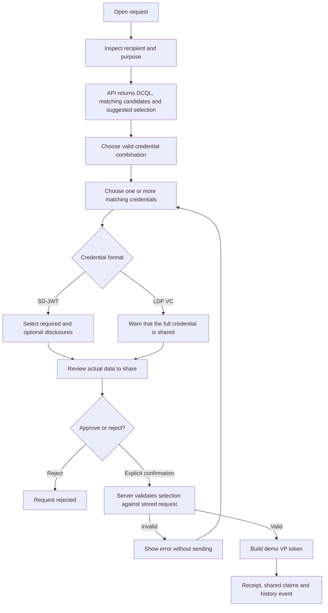
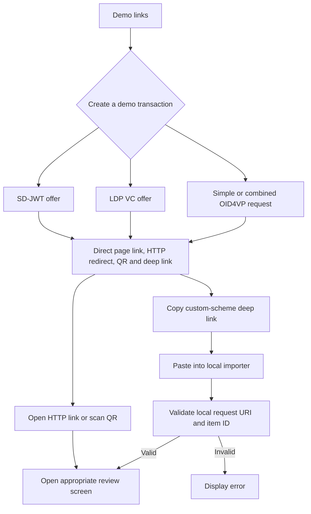
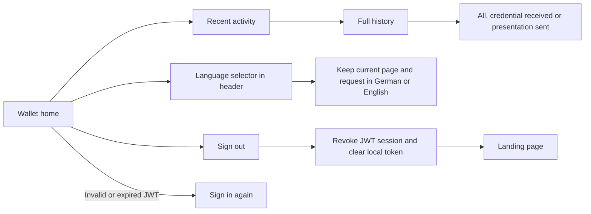
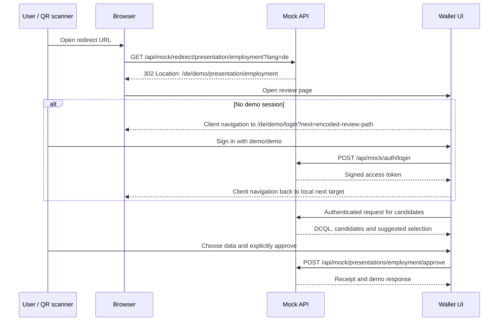
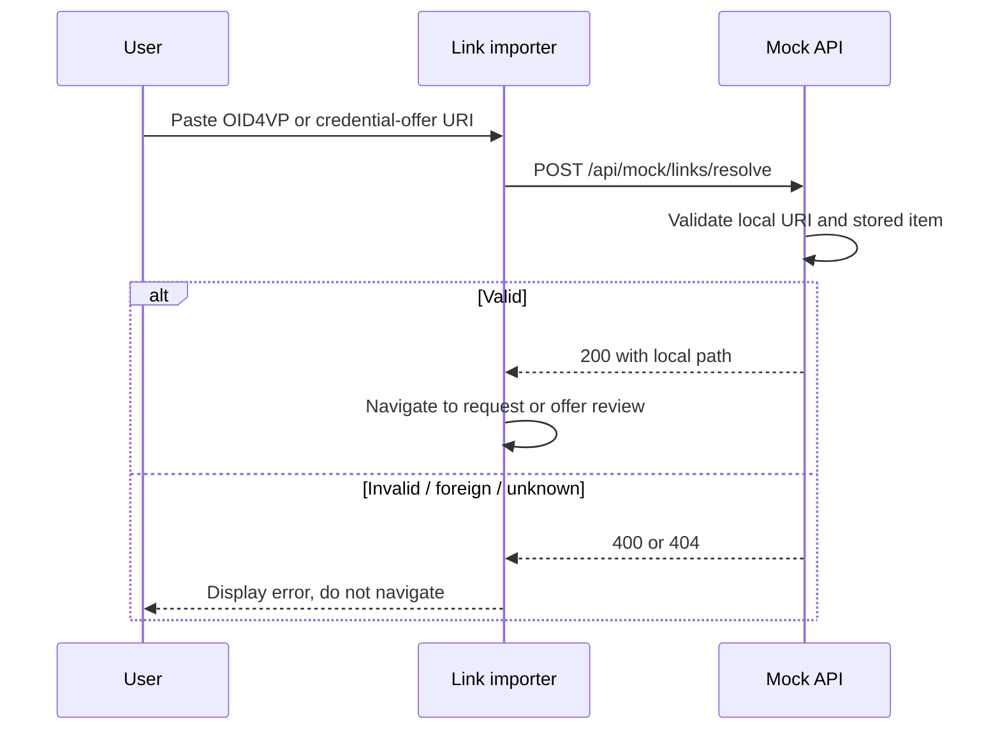
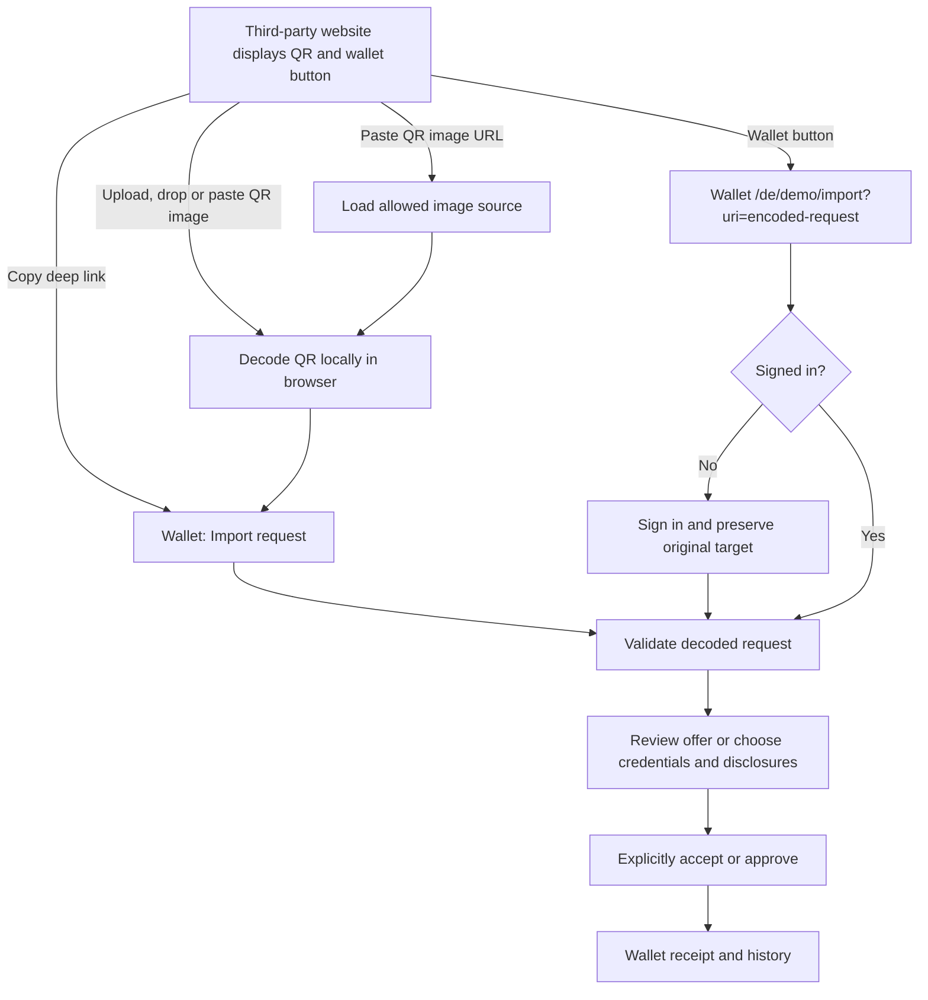

# XFSC Cloud Wallet

A simplified wallet UI with two separate operating modes: a configurable Keycloak-backed wallet and a local JWT-backed mock demonstrating credential receipt and manual OID4VP presentation consent.

## Quick start: local mock

```sh
npm ci
npm run demo
```

Open the simulated third-party website at http://localhost:4101, or the wallet at http://localhost:3000/de/demo. Username **demo**, password **demo**. No separate Keycloak server, database or backend process is required. `npm run demo` sets `MOCK_MODE=true` and starts both Next.js and a separate partner website on port 4101. Ctrl+C stops both processes.

An optional standalone API is available through `npm run mock:backend` at http://127.0.0.1:4100. It has its own in-memory state; the integrated UI uses its embedded backend, not that separate process.

The two landing-page Sign in actions are native demo-login links in mock mode and do not depend on client-side click interception. If Keycloak mode has no configuration, the landing page displays a configuration message; local development points to `npm run demo`.

## Keycloak mode

Copy `.env.local.example` to `.env.local` and set:

```dotenv
KEYCLOAK_AUTH_URL=https://auth.example.org
KEYCLOAK_REALM=your-tenant
KEYCLOAK_CLIENT_ID=wallet-web
WALLET_API_URL=https://your-tenant.example.org/api
WALLET_ACCOUNT_SERVICE_URL=https://your-tenant.example.org/api/accounts
```

Run `npm run dev` and open http://localhost:3000/de. Leave `MOCK_MODE` unset or false. The server embeds the public runtime auth/API configuration in the initial page; clicking Sign in does not first fetch `/api/keycloak-config` or OIDC discovery. The Keycloak adapter uses Authorization Code Flow with PKCE S256. Configure the public client, allowed redirect URIs and Web Origins for the application address. Never put a client secret in the browser configuration. Restart the app after changing environment values.

For a production build: `npm run build`, then `npm start`. For a local production-mode mock, set `MOCK_MODE=true` for **both** commands. A build is required before `npm start`.

## Visual previews

These are the concept images discussed during design, with German labels. They are **not screenshots of the running application**, nor pixel-exact representations of every implemented page. The screen inventory and flow diagrams below describe the implementation. No live browser walkthrough has been verified. The QR decoder and partner/backend flow have automated tests.

### Public landing page


### Wallet home


### Presentation consent


## Implemented mock screen inventory

| Screen | Route | Main actions |
| --- | --- | --- |
| Public landing | `/de` | Sign in, language switch, FAQ |
| Demo sign-in | `/de/demo/login` | Sign in using demo/demo; resume a pending local target |
| Wallet home | `/de/demo` | Receive/present entry points, credential cards, raw data, recent activity |
| Offer inbox | `/de/demo/offer` | Open an offer |
| Offer review and receipt | `/de/demo/offer/welcome` or `/de/demo/offer/:id` | Inspect issuer/claims, accept or deny, show receipt |
| Presentation inbox | `/de/demo/presentation` | Open a presentation request |
| Presentation selection and receipt | `/de/demo/presentation/employment` or `/de/demo/presentation/:id` | API preselection, credential/disclosure choices, review, approve or reject, inspect response |
| History | `/de/demo/history` | Filter received credentials and sent presentations |
| Language selector | Header on landing, login and wallet | Switch Deutsch / English while keeping the current flow; old settings URLs redirect home |
| Link generator and importer | `/de/demo/links` | Create SD-JWT/LDP offers or simple/combined OID4VP requests; show QR, copy/import deep links |
| Third-party request import | `/de/demo/import` | Partner redirect, deep link, QR image URL, file upload, drop or clipboard image |

`/en/demo/...` provides English navigation. Demo interface labels, consent/import text and known fixture display labels switch language. Raw protocol payloads and stored data are not modified. New generated item IDs are displayed in the link generator. Demo screens and endpoints return 404 when mock mode is disabled.

## UX flows

### Sign-in, credentials and navigation



### Receive an offer


Previously processed offers cannot be accepted again. An accepted credential appears on the home screen.

### Presentation request and selective disclosure



Every credential, combination or disclosure change clears the confirmation. Missing required claims prevent submission. Server-side checks reject unknown candidates, extra disclosures, duplicate selections and invalid combinations. SD-JWT output contains only selected disclosures; LDP VC output contains the complete credential with a visible warning. Terminal requests cannot be approved again. API recommendations are not user consent.

The `candidates`, `approve`, `reject` routes and `selections/queryId/credentialId/disclosures` structure follow the locally supplied OID4VP Holder code. `suggestedSelection` and explicit combinations are mock extensions. The remote GitHub branch was not retrievable during implementation; equivalence to its latest revision has not been verified. See the [detailed mock notes](mock/README.md#oid4vp-auswahl-und-selektive-offenlegung).

### Generate and import links



### History, direct language switch and session end



## Redirects: exact behavior

### Browser links and QR codes

The internal link-generator QR still contains a normal HTTP redirect URL. The third-party demo QR contains the OID4VP/offer deep link directly:

```text
http://localhost:3000/api/mock/redirect/offer/welcome?lang=de
http://localhost:3000/api/mock/redirect/presentation/employment?lang=de
```

The backend returns **HTTP 302** with a relative `Location` pointing to `/de/demo/offer/welcome` or `/de/demo/presentation/employment`. `lang=en` selects `/en`; other values fall back to `/de`. The redirect itself does not accept an offer, disclose data, verify a token or perform fulfillment. Missing item IDs are reported by the subsequent review page.



A fresh unauthenticated entry preserves the requested local path and query in `next`. The sign-in form only resumes a target beginning with the current locale's `/demo/` prefix; other targets fall back to the demo home. On token expiry, the current pathname and query string are retained for sign-in. Tokens are not added to redirect URLs.

### Custom-scheme OID4VP and credential-offer links

```text
openid4vp://authorize?request_uri=<encoded local /api/mock/requests/presentation/:id URL>
openid-credential-offer://?credential_offer_uri=<encoded local /api/mock/requests/offer/:id URL>
```

These links can be handed to the wallet by the partner redirect, pasted into the import field, or decoded from a QR image. There is no native operating-system scheme registration or automatic browser handoff. The importer calls `POST /api/mock/links/resolve` with `{uri: ...}`. The API checks the scheme, same origin, expected request path, transaction type and stored item ID, and returns `{path: "/de/demo/..."}`. The UI adapts that path to the current locale and navigates there; **this is JSON plus client navigation, not HTTP 302**. It does not fetch arbitrary remote request URIs.



The `/api/mock/requests/...` endpoints return illustrative request/offer **JSON**. They are neither redirect endpoints nor proof that the request has been cryptographically verified.

### Real Keycloak redirects

Outside mock mode, Sign in uses the public config embedded by the server to construct the Keycloak login request with a fixed auth URL, realm and client ID. Keycloak returns to the wallet callback; the adapter handles the authorization response and PKCE exchange. Incoming `presentation` and `params` query values are carried into that callback. The local mock's JWT sign-in is a separate flow and does not contact Keycloak.

## API, tests and limitations

- [Required backend endpoints and mock/production responsibilities](docs/backend-endpoints.md)
- [Redirect routes and Bearer-token boundaries](docs/redirect-routes.md)
- [Mock API reference and protocol limitations](mock/README.md)
- [Helm chart, derived domain/tenant hostnames, Envoy HTTPRoutes and TLS](deployment/helm/README.md)
- [German implementation notes](UX-UMBAU.md)

```sh
npm run mock:test
npm run lint
npx tsc --noEmit
```

Backend tests cover JWT verification/revocation, receipt and presentation history, candidate suggestions, disclosure filtering, invalid selections, terminal request replay and local deep-link resolution. They do not constitute a browser end-to-end test or OID4VP conformance test.

State is in memory and resets on restart; demo/demo users share one demo account. SD-JWT signatures and key binding are local HMAC examples, not a production trust chain. LDP proofs are deliberately invalid test fixtures. No actual external verifier is contacted. Do not enable mock mode in a real deployment.


## Third-party website entry flow

The user starts on a third-party website, **not** in the wallet link generator. The included partner site runs at `http://localhost:4101` on a separate origin. It offers a presentation request and a credential offer, each with a QR image, image URL, deep link and a **Continue with my wallet** button.



### Ways to open the request

1. **Partner integration:** the button links to `http://localhost:3000/de/demo/import?uri=<URL-encoded OID4VP or offer URI>`. No token is included. If sign-in is required, the entire import target and query survive the login. The request then opens directly on its review page.
2. **Deep link:** paste into the wallet's **Anfrage importieren** screen, read it, and open the request.
3. **QR image URL:** paste the image's direct PNG/JPEG/WebP/GIF URL. The mock downloads it without forwarding wallet credentials, then the browser decodes the QR. Sources are restricted to the wallet origin and `MOCK_IMAGE_ORIGINS` (default `http://localhost:4101`). Unsupported sources display an error with the upload alternative. Add other demo source origins explicitly if needed; redirects to other image hosts are not followed.
4. **QR image:** upload a file, drag it onto the import area, or focus that area/input and paste an image from the clipboard with Ctrl/Cmd+V. Images are decoded locally, limited to 5 MB. A visible decoded request is shown before opening its review page.

The partner page has **QR image download**, **image URL** and **deep link** fields to exercise each entry. A QR may contain a local OID4VP/offer URI, a wallet import URL or a local HTTP redirect URL. The importer resolves these to the same review flow. Image reading alone never accepts an offer or shares credentials.

This is a partner-origin demo with locally generated request objects. Arbitrary external OID4VP request validation/fetching, native protocol registration and a result callback/automatic return to the partner are not implemented. No token, credential or VP is automatically sent back to the third-party page. After confirmation, the demo stays on the wallet receipt screen.


## Direct language switching

Use the language selector in the header on the landing page, login and wallet. It immediately switches the current route, preserves the query/hash and local login return target, and stores NEXT_LOCALE. In the authenticated mock it also saves the language preference with a non-blocking keepalive request. API recommendations and raw credential data keep their original identifiers. No settings screen is required; `/de/demo/settings` and `/de/wallet/settings` redirect to their respective home pages.


### Authentication guard before opening redirected requests

Protected demo pages verify the stored token with authenticated `GET /api/mock/auth/verify` before loading wallet data or mounting the import/consent UI. A missing token skips the verification call and opens sign-in directly. A 401/403, expired token or revoked session clears the local token and navigates to `/{locale}/demo/login?next=<encoded original path, query and fragment>`. Successful sign-in resumes that internal destination; external targets and login loops are refused. Valid sessions proceed without another sign-in. Token expiry schedules a fresh check even while the page is idle.

Temporary backend/network failures show a retry action without destroying the session or opening request data. Later protected API calls still enforce authorization and can trigger the same reauthentication flow. The real Keycloak wallet retains its SDK-based login interceptor; the explicit JWT verification guard described here is part of the local mock UI.

## Local Docker Keycloak test

See [LOCAL-LOGIN-TEST.md](LOCAL-LOGIN-TEST.md) for the isolated real-Keycloak login environment.

---

## Backend API contract for the XFSC Cloud Wallet (Keycloak mode)

Status: static analysis of `cloud-wallet-web-ui-refactoring-login-debug.zip`. This contract describes the existing client, not already implemented XFSC REST routes. The subsequently successful local Keycloak JS update is not included in the analyzed ZIP (`^23.0.0`). The separate demo mode is not a production contract.

### Base URLs and general rules

- `WALLET_ACCOUNT_SERVICE_URL` (fallback `NEXT_PUBLIC_API_URL_ACCOUNT_SERVICE`, default `/api/accounts`): base A for the 26 account operations.
- `WALLET_API_URL` (fallback `NEXT_PUBLIC_API_URL`, default `/api`): base B for dynamic plugins.
- All account calls use `Authorization: Bearer <access_token>`. No explicit tenant, group or user headers and no user ID in the request. The backend should validate token signature, issuer, audience, expiry and permissions and securely resolve the account and tenant (recommendation).
- JSON requests use `JSON.stringify`; only configuration saving explicitly sets `Content-Type: application/json`. The client should add this header for all JSON bodies. For cross-origin requests, configure CORS for the wallet origin, Authorization and methods.
- `src/service/apiService.ts` accepts any HTTP 2xx status but always calls `response.json()`. Therefore, do not return an empty 204 or unencoded text for these calls. For unused mutation results, `{ "success": true }` is suggested below, not an existing schema.
- Suggested backend status codes: 200 for successful JSON responses, 201 for creation with JSON, 400 for invalid input, 401 for invalid token, 403 for insufficient permissions, 404 for unknown resource, 409 for state conflict, 502/503 for unavailable downstream services. The current client evaluates only the status, not error bodies. Suggested error body: `{"error":"invalid_request","message":"..."}`.
- Path/query parameters and bodies not explicitly listed are absent from the current call. Pagination is not implemented. IDs and query parameters should be URL-encoded; some current calls interpolate them directly.

### 26 account operations

All paths are relative to base A. `Ack` = any valid JSON whose contents are not evaluated (see suggestion above). Types follow below. `wallet/` refers to `src/app/[locale]/wallet/`.

| # | Method | Path | Parameter / JSON-Body | Response | Caller | Suggested responsibility |
|---:|---|---|---|---|---|---|
| 1 | GET | `/configurations/list` | – | `DefaultConfig` | DiscoveryContext | Account |
| 2 | PUT | `/configurations/save` | `DefaultConfig` | Ack | DiscoveryContext | Account |
| 3 | GET | `/history/list` | – | `HistoryData` | wallet/page, history/page | Account/Audit |
| 4 | GET | `/plugin-discovery` | – | `PluginWrapper` or `Plugin[]` (inconsistency, see below) | DiscoveryContext | Plugin Registry / remove |
| 5 | POST | `/credentials/list` | `{search:string}` | `CodedVerifiableCredentials[]` | credentials/page | Credential Storage |
| 6 | GET | `/credentials/offers/list` | – | `OfferingData[]` | wallet/page, offering/page | OID4VCI Retrieval |
| 7 | PUT | `/credentials/offers/create` | `{credential_offer:string}` | Ack | offering/page | OID4VCI Retrieval |
| 8 | POST | `/credentials/offers/{requestId}/accept` | Path: requestId; `{keyId:string}` | Ack | offering/page | OID4VCI Retrieval + KMS |
| 9 | POST | `/credentials/offers/{requestId}/deny` | Path: requestId; `{keyId:""}` | Ack | offering/page | OID4VCI Retrieval |
| 10 | GET | `/credentials/schemas` | – | `IssuanceData[]` (see shape mismatch below) | issuance/page | Issuance / Schema Registry |
| 11 | POST | `/credentials/issue` | `{payload:object,type:string}` | `{credential_offer:string}` | issuance/page | Issuance |
| 12 | POST | `/presentations/list` | no body | `VerifiablePresentation[]` | presentations/page | Presentation History |
| 13 | GET | `/presentations/selection/all` | – | `PresentationDefinitionData[]` | selection/page | OID4VP Holder |
| 14 | GET | `/presentations/selection/{presentationId}` | Path: presentationId | `VerifiableCredentials[]` | ParamsProvider, PresentationSelection | OID4VP Holder + Storage |
| 15 | POST | `/presentations/proof/{presentationId}` | Path: presentationId; `{signKeyId:string,filters:VerifiableCredentials[]}` | Ack | PresentationSelection | OID4VP Holder + KMS |
| 16 | GET | `/kms/keyTypes` | – | `string[]` | CreateDidModal | KMS |
| 17 | GET | `/kms/did/list` | – | `DidData` | did/page, DidSelection | DID/KMS |
| 18 | POST | `/kms/did/create` | `{keyType:string}` | Ack | did/page | DID/KMS |
| 19 | GET | `/devices/list` | – | `DevicesData[]` | pairing-management/page | Device Pairing / optional |
| 20 | GET | `/devices/link` | – | JSON string | pairing-management/page | Device Pairing / optional |
| 21 | POST | `/devices/block/{id}` | Path: id = remoteDid; no body | Ack | pairing-management/page | Device Pairing / optional |
| 22 | DELETE | `/devices/{id}` | Path: id = remoteDid | Ack | pairing-management/page | Device Pairing / optional |
| 23 | GET | `/credentials/backup/all` | – | `BackupList` | backup/page | Backup / optional |
| 24 | GET | `/credentials/backup/link/upload` | Query: `name` (string) | `BackupUpload` | AddBackupModal | Backup / optional |
| 25 | GET | `/credentials/backup/link/download` | Query: `bindingId` (string) | `BackupQrCodeData` | backup/page | Backup / optional |
| 26 | DELETE | `/credentials/backup/{bindingId}` | Path: bindingId | `BackupQrCodeData` typed, content ignored | backup/page | Backup / optional |

### Configuration and history

```json
{"historyLimit":10,"language":"de"}
```

`GET configurations/list` returns this object. On any loading error, DiscoveryContext attempts a PUT with `{"language":"en","historyLimit":10}`; an initial 200 response with defaults is therefore useful. The current client has no separate account creation or account profile operation.

`GET history/list`:

```json
{"events":[{"event":"Credential received","timestamp":"2026-11-25T12:00:00Z","type":"credential","userId":"user-123"}]}
```

All event fields are strings. Empty response: `{"events":[]}`. `historyLimit` is used in the UI; there is no limit query parameter.

### Credential Storage

`POST credentials/list` initially sends `{"search":""}`, then search text (500 ms debounce). The response is a grouped map, not a flat list:

```json
[
  {"description":{"id":"group-1","name":"Employee","purpose":"Identification","format":"ldp_vc"},
   "credentials":{"cred-1":{"type":"ldp_vc","data":"{\"id\":\"urn:uuid:example\",\"type\":[\"VerifiableCredential\"],\"credentialSubject\":{\"name\":\"Example\"}}"}}}
]
```

`description.id` is required; name, purpose and format are optional. Credential IDs are map keys. `data` and `type` are strings. Only `type === "vc+sd-jwt"` triggers SD-JWT decoding; otherwise JSON.parse(data) is used. `dc+sd-jwt` and other compact JWTs require a client change. Empty list: `[]`. The analyzed Keycloak client has no explicit credential detail, delete or update endpoint. Details are displayed locally from the list.

### OID4VCI: offers and issuance

- Create: `{"credential_offer":"openid-credential-offer://?..."}`; the string comes from the input field. The backend imports and manages the offer; exact permitted URI forms are not specified by the client.
- Accept: `{"keyId":"key-123"}`; the value is the ID from `DidSelection`, not the DID string. Deny sends `{"keyId":""}`. `requestId` comes from the offer list. The client does not send a separate `tx_code` on acceptance; the contract must be extended for PIN-protected offers.
- Offer list: `OfferingData[]` with `groupId`, `requestId`, `metadata`, `offering`, `status`, `timestamp`. The UI reads `offering.credential_configuration_ids` or the keys of `metadata.credential_configurations_supported`. The complete TypeScript schema is in the appendix.
- Schemas: `IssuanceData[]`, each element a map `configurationId -> Issuance`. The UI needs `display`, `credential_definition`, `format`, `schema.data` (JSON Schema) and `schema.ui` (RJSF UI Schema). Inconsistently, the list is treated as a map when building the table and as an array (`data.find`) when locating the form. Fix the client rather than introducing two incompatible backend formats.
- Issue: `{"type":"employee","payload":{"name":"Example","pin_otp":"1234"}}`. `type` is the schema/configuration key; `payload` contains dynamic form data. `pin_otp` is added by the form and is not a universally required API field. Response `{"credential_offer":"openid-credential-offer://?..."}` is used as a link/QR code.
- Recommendation: implement offer import and acceptance as stateful, account-bound operations; do not execute repeated acceptance twice. Protect external offer URL and metadata retrieval against SSRF.

### OID4VP: presentation selection and proof

`GET presentations/selection/all` returns a list of presentation definitions (currently Presentation Exchange, not DCQL):

```json
[{"id":"presentation-1","name":"Employment","purpose":"Proof of employment","input_descriptors":[{"id":"employee","format":{"vc+sd-jwt":{}},"constraints":{"fields":[{"path":["$.vct"]}]}}]}]
```

`GET presentations/selection/{presentationId}` returns grouped **already decoded** credentials (`VerifiableCredentials[]`, unlike credentials/list). `presentationId` corresponds to the definition ID or stored URL parameter `presentation`.

`POST presentations/proof/{presentationId}` sends, for example:

```json
{"signKeyId":"key-123","filters":[{"description":{"id":"presentation-1","name":"Employment","purpose":"Proof of employment","format":"vc+sd-jwt"},"credentials":{"cred-1":{"vct":"employee","credentialSubject":{"name":"Example"}}}}]}
```

`signKeyId` is the selected DID/key ID. `filters` contains one group per selected credential; the UI sends the decoded credential data. The backend should use only IDs and permitted selection parameters as references, load original credentials from its own storage, and verify ownership and request binding. Do not sign client-supplied claims without verification. The existing UI does not offer explicit DCQL or disclosure selection in this Keycloak flow. There is no explicit OID4VP reject or import endpoint in this mode; these functions would need to be added.

`POST presentations/list` without a body returns `VerifiablePresentation[]`: `description` plus a `credentials` map of presentation objects, each containing `verifiableCredential: CredentialData[]`. The UI extracts credential cards from these. Empty lists are `[]`.

### DID and KMS

`GET kms/keyTypes` returns an array of key type strings supported by the backend, e.g. `["Ed25519"]` (example, not a prescribed list). `POST kms/did/create` sends `{ "keyType": "Ed25519" }`.

`GET kms/did/list` returns:

```json
{"list":[{"id":"key-123","did":"did:key:example","timestamp":"2026-11-25T12:00:00Z"}]}
```

Empty response: `{"list":[]}`. `id` must be resolvable for offer acceptance and presentation proof. Private keys remain in the KMS. The client has no explicit key deletion or rotation endpoints.

### Device pairing and backup

`GET devices/list` returns `DevicesData[]` (schema in appendix). The table uses `remoteDid` as `id` for block and delete. `GET devices/link` returns a **JSON string**, e.g. `"https://example.org/pair/token"`, not an object. The link is displayed as a QR code. There are no further pairing protocol calls in the wallet client.

`GET credentials/backup/all` returns `{"backups":[]}` or entries with `bindingId`, `name`, `timestamp`, `credentials`, `user_id` (all strings). Upload/download link response:

```json
{"expiresInSeconds":300,"path":"https://example.org/backup/token"}
```

The UI uses `path` as the QR content. The actual upload/download is not performed by this UI. Link tokens should be short-lived and bound to their purpose and account. Since link creation uses GET, prevent caching; consider POST in a future contract revision. Backup and device functions are optional if their UI routes are disabled.

### Dynamic plugins (base B, in addition to the 26 operations)

| Method | Path | Parameters / Body | Response | Caller |
|---|---|---|---|---|
| GET | `/dynamic/plugins{url}/application/metadata` | `url` from discovery, appended directly; Bearer | any JSON object | plugin-overview / DetailsModal |
| GET | `/dynamic/plugins{url}/main.js` | `url` from discovery; no explicit Bearer in RemoteComponent call | JavaScript module | plugins/[plugin]/page |
| POST | `/dynamic/plugins/{plugin}/application/event/accounts.record` | `plugin` = route; Bearer; `{message:string,type:"consent"}` | Ack | ParamsProvider |

Discovery element: `{name:string,route:string,url:string}`. `WalletSideMenu`, plugin overview and plugin page expect a wrapper `{ "plugins": [...] }`; DiscoveryContext and ParamsProvider type or treat the result as a direct array. For plugin-free operation, `{"plugins":[]}` is appropriate after fixing ParamsProvider; the local mock currently returns `[]`. This inconsistency must be fixed in the frontend. Dynamically loaded code receives the access token as a prop; allow only trusted plugins or remove the feature. Further calls inside external plugins cannot be determined from this repository.

### Keycloak (not Account Service)

The adapter uses Authorization Code + PKCE S256, public client ID, redirect URI and nonce. Standard OIDC endpoints are called by the adapter, not the Account Service. Explicit logout hook: `POST {auth}/realms/{realm}/protocol/openid-connect/logout`, headers `Authorization: Bearer ...`, `Content-Type: application/x-www-form-urlencoded`, cookies included, body `client_id=...&refresh_token=...`. This hook does not require a JSON response. Retain the updated `keycloak-js` with nonce enabled; the old ZIP version is not the locally repaired version.

### Local Next.js routes and demo (do not implement as Account Service contract)

The route `/api/local-accounts/{...path}` is a development fixture without token validation, active only with `LOCAL_ACCOUNT_MOCK=true` and in development. It returns defaults and empty lists; in particular, the empty arrays for DID/backup do not conform to the contract. It does not implement complete mutations. Other local routes: `/api/credentials`, `/api/keycloak-config`, `/api/presentations`, `/api/presentation-definition`, `/api/offering`, `/api/plugins`. These are not the fixed account calls listed above.

The separate JWT demo mode uses `/api/mock` and `mock/backend.mjs`, with its own data models. It must not be mixed with the Keycloak contract. The existing README already describes the demo flow. The 26 operations and, where applicable, the three plugin routes are relevant for preparing the Account Service.

### Suggested implementation order

1. Account resolution, configuration, history and empty plugin discovery; disable the mock and test wallet startup.
2. Credential Storage and DID/KMS: lists, search, key types and DID creation.
3. OID4VCI offer import, list, accept/deny; then optionally issuance schemas and issue.
4. OID4VP request management, candidate selection, proof and presentation history. Modernize the DCQL and disclosure contract separately.
5. Implement backup, device pairing and plugins only if functionally required; otherwise remove navigation and calls.

The suggested service assignment is not a verified mapping to existing XFSC REST paths. These must be checked against the respective service repositories. No build or backend integration tests were performed.

### Appendix: original TypeScript data models

Copied unchanged from `src/service/types.ts` so that nested metadata, schema, credential and presentation types remain fully traceable. The types are client declarations, not validated OpenAPI schemas; `any` and inconsistencies have deliberately not been silently corrected.

```typescript
import { type GenericObjectType } from '@rjsf/utils';
import type { JSONSchema7 } from 'json-schema';

export interface DidData {
  list: Did[];
}

export interface Did {
  id: string;
  did: string;
  timestamp: string;
}

export interface DevicesData {
  added: string;
  eventType: string;
  group: string;
  protocol: string;
  remoteDid: string;
  routingKey: string;
  topic: string;
  recipientDid: [string];
  properties: {
    account: string;
    greeting: string;
  };
}

export interface PluginsData {
  id: string;
  name: string;
  uploaded: string;
  issuer: string;
}

export interface BackupList {
  backups: BackupData[];
}

export interface BackupData {
  bindingId: string;
  name: string;
  timestamp: string;
  credentials: string;
  user_id: string;
}

export interface BackupUpload {
  expiresInSeconds: number;
  path: string;
}

export interface HistoryData {
  events: Events[];
}

export interface Events {
  event: string;
  timestamp: string;
  type: string;
  userId: string;
}

export interface IssuanceSchemaData {
  id: string;
  name: string;
}

export interface BackupQrCodeData {
  expiresInSeconds: number;
  path: string;
}

export type Format = Record<
  string,
  {
    proof_type?: string[];
  }
>;

export interface CredentialsData {
  id: string;
  credential: string;
}

export interface KeycloakConfig {
  mock?: boolean;
  baseUrl: string;
  realm: string;
  clientId: string;
  auth: string;
}

export interface KeycloakAndMetadata {
  keycloakConfig: KeycloakConfig;
  metadata: OidcMetadata;
}

export interface OidcMetadata {
  issuer: string;
  authorization_endpoint: string;
  token_endpoint: string;
  token_endpoint_auth_methods_supported: string[];
  token_endpoint_auth_signing_alg_values_supported: string[];
  userinfo_endpoint: string;
  check_session_iframe: string;
  end_session_endpoint: string;
  jwks_uri: string;
  registration_endpoint: string;
  scopes_supported: string[];
  response_types_supported: string[];
  acr_values_supported: string[];
  subject_types_supported: string[];
  request_object_signing_alg_values_supported: string[];
  display_values_supported: string[];
  claim_types_supported: string[];
  claims_supported: string[];
  claims_parameter_supported: boolean;
  service_documentation: string;
  ui_locales_supported: string[];
  revocation_endpoint: string;
  introspection_endpoint: string;
  frontchannel_logout_supported: boolean;
  frontchannel_logout_session_supported: boolean;
  backchannel_logout_supported: boolean;
  backchannel_logout_session_supported: boolean;
  grant_types_supported: string[];
  response_modes_supported: string[];
  code_challenge_methods_supported: string[];
}

export type CredentialSubject = Record<string, string | DetailedSubject>;

export interface Proof {
  type: string;
  created: string;
  challenge?: string;
  domain?: string;
  jws: string;
  proofPurpose: string;
  verificationMethod: string;
}

export interface CredentialData {
  '@context'?: Array<string | object>;
  id?: string;
  holder?: string;
  type?: string | string[];
  Type?: string[];
  vct: string;
  issuer?: string;
  issuanceDate?: string;
  credentialSubject?: CredentialSubject;
  proof?: Proof;
}

export interface JWT {
  header: JWTHeader;
  payload: JWTPayload;
  signature: string;
}

export interface JWTHeader {
  alg: string;
  kid: string;
  typ: string;
}

export interface JWTPayload {
  cnf: {
    jwk: JWK;
  };
  iat?: number;
  iss?: string;
  vct: string;
  _sd_alg: string;
  [key: string]: any;
}

export interface JWK {
  alg?: string;
  crv?: string;
  kid?: string;
  kty?: string;
  x?: string;
}

export interface Credential {
  data: string;
  type: string;
}

export type ValidCredential = Credential & ({ type: string | string[] } | { Type: string } | { vct: string });

export interface CredentialInPresentation {
  '@context': string[];
  id?: string;
  holder?: string;
  type: string[];
  issuer?: string;
  issuanceDate?: string;
  proof?: Proof;
  verifiableCredential: CredentialData[];
}

export interface Description {
  id: string;
  name?: string;
  purpose?: string;
  format?: string;
}

export interface CredentialOffer {
  credential_offer: string;
}

export type DetailedSubject = Record<
  string,
  {
    name: string;
    type: string;
  }
>;

export type CodedCredentialList = Record<string, Credential>;

export type CredentialList = Record<string, CredentialData>;

export type CredentialPresentationList = Record<string, CredentialInPresentation>;

export interface VerifiableCredentials {
  description: Description;
  credentials: CredentialList;
}

export interface CodedVerifiableCredentials {
  description: Description;
  credentials: CodedCredentialList;
}

export interface VerifiablePresentation {
  description: Description;
  credentials: CredentialPresentationList;
}

export interface DefaultConfig {
  historyLimit: number;
  language: string;
}

export interface SchemaData {
  data: SchemaDataWithId;
  ui: GenericObjectType;
}

export interface SchemaDataWithId extends JSONSchema7 {
  $id: string;
  $schema: string;
}

export interface OfferingData {
  groupId: string;
  requestId: string;
  metadata: Metadata;
  offering: Offering;
  status: string;
  timestamp: string;
}

export interface Metadata {
  credential_issuer: string;
  authorization_servers: string[];
  credential_endpoint: string;
  batch_credential_endpoint: any;
  notification_endpoint: any;
  signed_metadata: any;
  credential_identifiers_supported: boolean;
  deferred_credential_endpoint: any;
  credential_response_encryption: CredentialResponseEncryption;
  display: any;
  credential_configurations_supported: CredentialConfigurationsSupported;
}

export interface CredentialResponseEncryption {
  alg_values_supported: any;
  enc_values_supported: any;
  encryption_required: boolean;
}

export type CredentialConfigurationsSupported = Record<string, CredentialConfiguration>;

export interface CredentialConfiguration {
  format: string;
  scope: string;
  cryptographic_binding_methods_supported: string[];
  credential_signing_alg_values_supported: string[];
  credential_definition: CredentialDefinition;
  proof_types_supported: ProofTypesSupported;
  display: DetailedDisplay[];
}

export interface Offering {
  credential_issuer: string;
  credential_configuration_ids: string[];
  grants: Grants;
}

export interface Grants {
  authorization_code: AuthorizationCode;
  'urn:ietf:params:oauth:grant-type:pre-authorized_code': UrnIetfParamsOauthGrantTypePreAuthorizedCode;
}

export interface AuthorizationCode {
  issuer_state: string;
}

export interface UrnIetfParamsOauthGrantTypePreAuthorizedCode {
  'pre-authorized_code': string;
  tx_code: TxCode;
  interval: number;
}

export interface TxCode {
  input_mode: string;
  length: number;
  description: string;
}

export type IssuanceData = Record<string, Issuance>;

export interface Issuance {
  format: string;
  scope: string;
  cryptographic_binding_methods_supported: string[];
  credential_signing_alg_values_supported: string[];
  credential_definition: CredentialDefinition;
  proof_types_supported: ProofTypesSupported;
  display: DetailedDisplay[];
  topic: string;
  schema: SchemaData;
}

export interface CredentialDefinition {
  type: string[];
  credentialSubject: CredentialSubjectOffering;
}

export type CredentialSubjectOffering = Record<string, Display>;

export interface Display {
  display?:
    | Array<{
        name: string;
        locale?: string;
      }>
    | {
        name: string;
        locale?: string;
      };
}

export interface DetailedDisplay {
  name: string;
  locale: string;
  logo: Logo;
  background_color: string;
  text_color: string;
}

export interface Logo {
  url: string;
  alternative_text: string;
}

export type ProofTypesSupported = Record<
  string,
  {
    proof_signing_alg_values_supported: string[];
  }
>;

export interface Constraints {
  limitDisclosure?: Disclosure;
  fields?: Field[];
}

export type Disclosure = 'required' | 'preferred';

export interface Field {
  path: string[];
  id?: string;
  purpose?: string;
  filter?: Filter;
  name?: string;
}

export interface Filter {
  type: string;
  pattern: string;
}

export interface InputDescriptor {
  id: string;
  format: Format;
  constraints: Constraints;
  group?: string[];
}

export interface PresentationDefinitionData {
  id: string;
  name: string;
  purpose: string;
  input_descriptors: InputDescriptor[] | null;
  format?: Format;
}

export interface PluginDetails {
  id: string;
  name: string;
  description: string;
}

```
